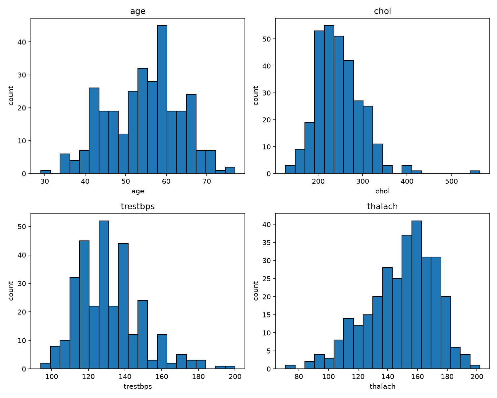
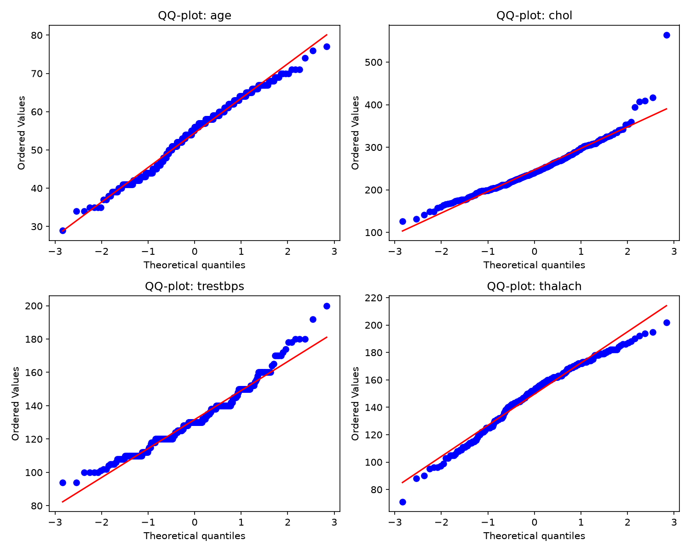
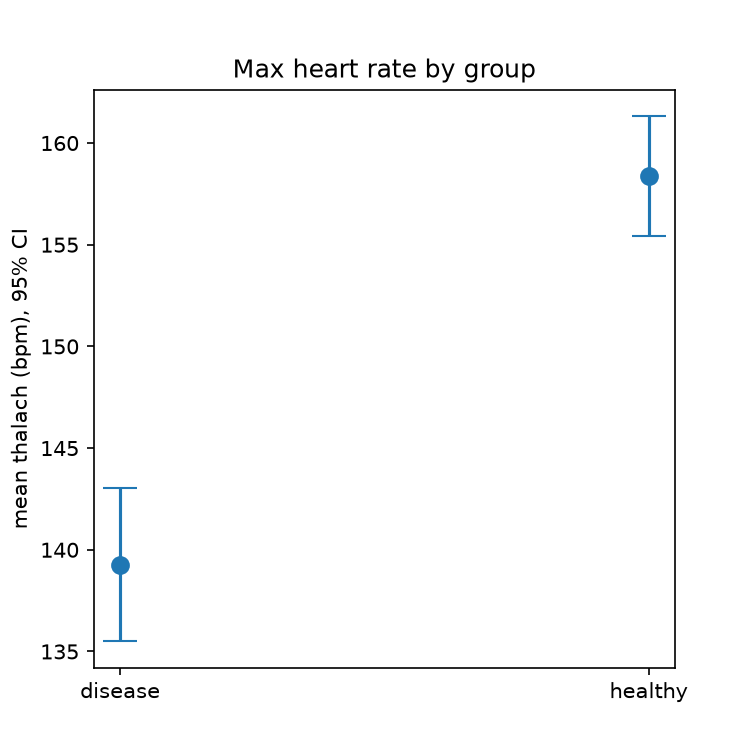
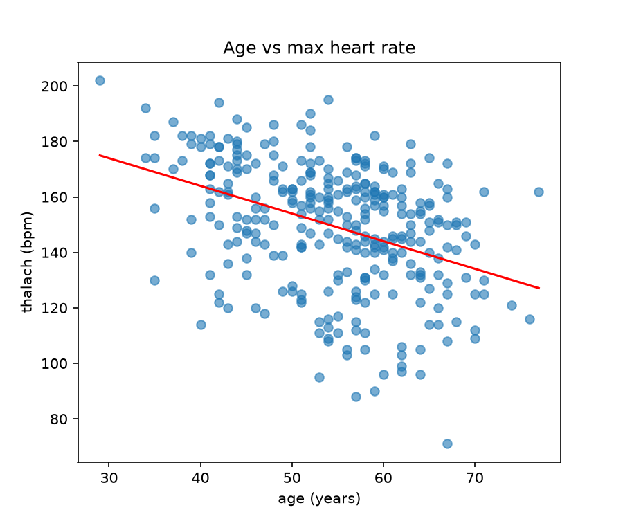
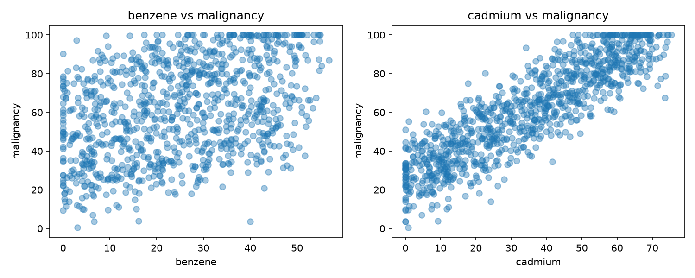
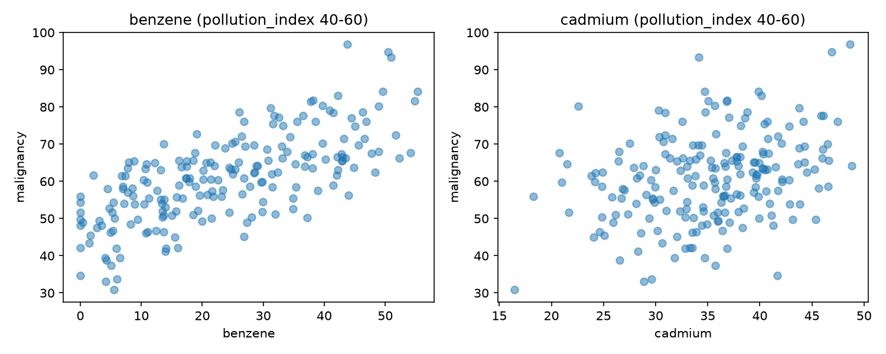

# CSPC - Computer Science for Physics and Chemistry

My coursework repository. Each practical is under PW<n>/Lab <X>/.

## Setup

Create the environment for a given lab:
conda env create -f PW<n>/Lab\ <X>/environment.yml
conda activate cspc

---

## PW1 - Lab A: Reproducible Foundations

**What I built:**

- A radioactive decay simulation with two implementations (pure-Python loop and vectorised NumPy), tested with pytest, and a speed comparison script.

**Speed comparison (loop vs NumPy):**

- loop : 2.0864 s
- numpy : 0.0002 s
- speed-up: 12350.5x faster

**Tests:** all passing? yes

**Conclusion:**

- The NumPy vectorised version is dramatically faster than the pure-Python loop because it processes all atoms at once instead of looping over each one individually. All three tests pass, confirming the simulation correctly rejects negative decay rates and matches the theoretical decay law on average.

---

## PW1 - Lab B: Data, Plotting, and Automation

**What the data showed:**

- The observed decay data (decay_observed.csv) shows the atom count dropping from 5000 at t=0 down toward near-zero by t=20, following the expected shape of radioactive decay.

**Did it match the analytical law?**

- Yes, comparing the two panels of figure.png, the observed scatter points closely follow the same shape as the analytical curve N0*exp(-lam*t), confirming the data is consistent with the decay law (lambda = 0.3).

**Snakemake pipeline:**

- The Snakefile defines one rule that regenerates figure.png from decay_observed.csv by running plot_STUDENT.py, and Snakemake only reruns it when the input file is newer than the output, avoiding unnecessary recomputation.

---

## PW2 - Lab B: Optimization in Chemistry

**How the three methods compared:**

- On f(x) = (x-3)^2 + 1, gradient descent, Newton and SLSQP all gave x = 3.
- On g(x) = x^4 - 3x^2 + x + 5, the results depended on the start. From x0=0, Newton landed on x = 0.17, where g'' < 0, so it is a maximum. From x0=2, gradient descent and Newton stopped at the local minimum x = 1.13, while SLSQP reached the lowest point x = -1.30.
- So the methods only agree on the easy problem. On the harder one, the starting point and the method both change the answer.

**Fitted rate constant:**

- The fit gave k = 0.262, close to the expected 0.25. The difference comes from noise in the data.

**Equilibrium composition:**

- Newton and SLSQP agree: x = 0.664, giving H2 = I2 = 0.336 mol and HI = 1.328 mol.

**Titration equivalence point:**

- The pH curve is steepest at 50.0 mL, so that is the equivalence point.

---

# PW3 - Data, Distributions, Testing, and Causation

All scripts are in this folder (`task1.py` ... `task8.py`) and were run in the `cspc` conda environment (pandas, numpy, scipy, matplotlib).

**Data sources**

- `heart.csv`: Heart Disease (Cleveland), Kaggle / UCI Machine Learning Repository: https://www.kaggle.com/datasets/ritwikb3/heart-disease-cleveland (303 patients, 14 columns).
- `chemicals_cancer.csv`: synthetic dataset provided on Moodle (1000 patients; columns `benzene`, `cadmium`, `pollution_index`, `age`, `malignancy`).

---

## Session 1 - Characterise the data

### 1. Loading (`task1.py`)

The data is loaded with `pd.read_csv`. The shape is (303, 14). The four continuous columns `age`, `chol`, `trestbps`, `thalach` are isolated in a separate DataFrame.

### 2. Shape of each variable (`task2.py`, `distributions.png`)

- **age**: roughly bell-shaped, peak around 55-60, slightly longer tail toward young ages.
- **chol**: clearly right-skewed, peak around 220-250, long right tail with a few extreme values (one patient above 550).
- **trestbps**: right-skewed, peak around 120-130, tail up to 200. The histogram is "jagged" because blood pressure is often recorded in round numbers (120, 130, 140).
- **thalach**: left-skewed, peak around 160, long tail toward low heart rates.

### 3. Normality (`task3.py`, `qqplots.png`)

Two kinds of evidence were combined: QQ-plots (graphical) and the Shapiro-Wilk test (numerical, H0 = data is normal, reject if p < 0.05), plus the skewness.

| Variable | Shapiro W | p-value | Skewness | QQ-plot                                          | Verdict              |
| -------- | --------- | ------- | -------- | ------------------------------------------------ | -------------------- |
| age      | 0.9865    | 0.006   | -0.21    | points follow the line closely                   | approximately normal |
| chol     | 0.9473    | 5.9e-09 | 1.13     | strong upward bend on the right, extreme outlier | not normal           |
| trestbps | 0.9665    | 1.8e-06 | 0.70     | stepped, bends up on the right                   | not normal           |
| thalach  | 0.9765    | 7.0e-05 | -0.53    | systematic S-shaped deviation at both ends       | not normal           |

Reasoning: with about 300 observations the Shapiro-Wilk test is very sensitive and rejects normality even for small deviations, so the p-value alone is not enough. For `age`, W is very close to 1, skewness is small and the QQ-plot is almost straight, so it is treated as approximately normal despite p = 0.006. For `chol`, `trestbps` and `thalach`, the test and the plots agree that the deviation is real.

---

## Session 2 - Draw conclusions

### 4. Do heart-disease patients reach a different maximum heart rate? (`task4a.py`, `task4b.py`)

`thalach` was split by `target`: disease (n = 139) and healthy (n = 164).

**Choice of method.** `thalach` is not normal (Session 1), and the Shapiro-Wilk test inside the groups gives p = 0.35 for the disease group but p = 0.0005 for the healthy group. Because normality is not guaranteed in both groups, the main test is the **Mann-Whitney U test**, which does not assume normality. As a robustness check, the **Welch t-test** (no equal-variance assumption) was also computed.

| Test           | Statistic  | p-value  |
| -------------- | ---------- | -------- |
| Mann-Whitney U | U = 5806.5 | 1.86e-13 |
| Welch t-test   | t = -7.858 | 9.11e-14 |

Medians: 142 (disease) vs 161 (healthy). Means: 139.3 vs 158.4.

**Conclusion.** Both tests agree with p far below 0.05: the groups genuinely differ. Patients with heart disease reach a maximum heart rate about 19 bpm lower on average than healthy patients.

**Precision of the means** (SEM = std / sqrt(n); 95% CI = mean +/- 1.96 SEM):

| Group   | Mean   | SEM  | 95% CI           | n   |
| ------- | ------ | ---- | ---------------- | --- |
| disease | 139.26 | 1.92 | [135.50, 143.02] | 139 |
| healthy | 158.38 | 1.50 | [155.44, 161.32] | 164 |

The two confidence intervals do not overlap (gap of about 12 bpm), so the picture agrees with the tests.

### 5. Do age and thalach move together? (`task5.py`)

- Pearson r = -0.394 (p = 1.1e-12), Spearman rho = -0.392 (p = 1.5e-12), slope = -0.997 bpm per year.
- Interpretation: there is a moderate negative relationship; the older the patient, the lower the maximum heart rate, by about 1 bpm per year of age. Since `thalach` is not normal, the rank-based Spearman coefficient is the main measure; it is almost identical to Pearson. The points are widely scattered (r^2 is about 0.15), so age explains only a small part of the variation.

---

## Dataset 2 - The chemical-exposure mystery

### 6. Naive analysis (`task6b.py`)

| Chemical | Pearson r | Spearman rho |
| -------- | --------- | ------------ |
| benzene  | 0.385     | 0.377        |
| cadmium  | 0.880     | 0.885        |

Taken at face value, **cadmium** appears to be the cause of malignancy (r = 0.88, p below the numerical precision), while benzene looks only moderately related.

### 7. Look again - the confounder (`task7.py`)

The correlation matrix shows that `pollution_index` is almost identical to cadmium (r = 0.982) and strongly related to malignancy (r = 0.895), while it is nearly unrelated to benzene (r = 0.054) and age is unrelated to everything. So pollution could create a fake link between cadmium and malignancy.

To test this, the effect of pollution was removed in two ways:

1. **Restriction:** only patients with similar pollution are kept, then the correlations are recomputed.
2. **Partial correlation:** the linear effect of `pollution_index` is removed from both the chemical and malignancy (residuals), then the residuals are correlated.

| Analysis                       | benzene r          | cadmium r         |
| ------------------------------ | ------------------ | ----------------- |
| Naive (all 1000 patients)      | 0.385              | 0.880             |
| pollution in (40, 60), n = 199 | 0.702              | 0.316             |
| pollution in (45, 55), n = 94  | 0.658 (p = 6e-13)  | -0.040 (p = 0.70) |
| Partial correlation            | 0.755 (p = 7e-185) | 0.013 (p = 0.69)  |

Note: in the wider window (40-60) cadmium still shows r = 0.32 because cadmium follows pollution almost perfectly (r = 0.98), so pollution still varies inside that window; the narrower window and the partial correlation remove it.

**Conclusion.** Once pollution is held fixed, cadmium's association disappears (r close to 0, p about 0.7), while benzene's association remains and becomes stronger (r = 0.66-0.76). **Benzene is the real cause of malignancy; cadmium only looked guilty** because it rises and falls together with the pollution index, which is the real driver (a confounder). Caveat: the dataset is synthetic, and in real data a correlation analysis alone could not prove causation.

### Bonus - How unpredictable is a category? (`task8.py`)

The Shannon entropy H = -sum(p log2 p) was used (maximum = 1 bit for a binary variable; the closer to the maximum, the more balanced the column and the harder it is to guess).

| Column | Proportions        | Entropy    | Normalized |
| ------ | ------------------ | ---------- | ---------- |
| target | 0: 0.541, 1: 0.459 | 0.995 bits | 0.995      |
| sex    | 1: 0.680, 0: 0.320 | 0.905 bits | 0.905      |

`target` is almost perfectly balanced (like a fair coin flip), so it is very hard to guess without extra information; always guessing the majority class is right only 54% of the time. `sex` is more lopsided (68% / 32%), so it is somewhat easier to guess.

---

## Files

`task1.py` loading, `task2.py` distributions, `task3.py` normality, `task4a.py` / `task4b.py` heart-rate comparison and CI plot, `task5.py` age vs thalach, `task6b.py` naive analysis, `task7.py` confounder analysis, `task8.py` bonus (entropy). Plots: `distributions.png`, `qqplots.png`, `thalach_means.png`, `age_thalach.png`, `naive_scatter.png`, `controlled_scatter.png`.
